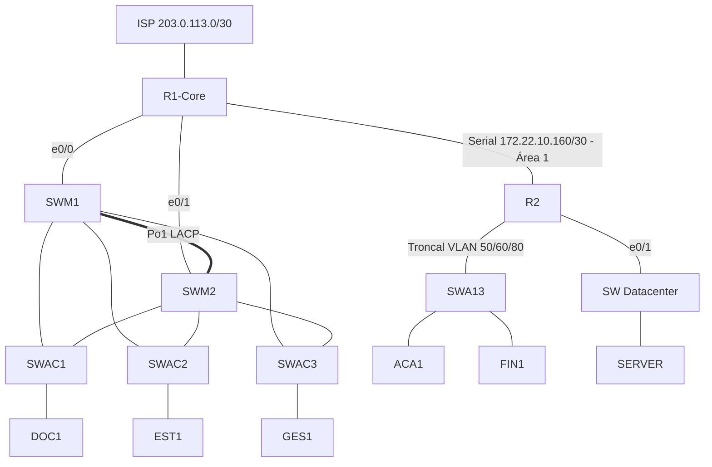

# Proyecto Final - Red para Mediana Empresa (Equipo 4)

Red segura, escalable y segmentada por departamentos, implementada en PNETLab para la materia Conmutación y Enrutamiento (TI-203) del Instituto Tecnológico de las Américas (ITLA).

## Integrantes

Anel Mejia, Leudy Abreu, Oscar Valois y Robert Reyes.

## Tecnologías

- Segmentación por VLANs, con router-on-a-stick en R2 y VLAN nativa 999 (Blackhull) en los troncales
- VTP versión 2 con dos dominios (CORE-ITLA en la sede central y SUC-R2 en la sucursal)
- EtherChannel LACP de tres enlaces entre SWM1 y SWM2, y RPVST+ con raíces alineadas al HSRP
- HSRP versión 2 en los switches multicapa
- OSPFv2 multiárea (área 0 y área 1 stub) con propagación de la ruta por defecto, y OSPFv3 para IPv6
- NAT con sobrecarga hacia el ISP
- ACLs por segmento y ACL de entrada hacia Internet
- Acceso remoto solo por SSH v2, restringido a las redes de Gestión
- PortFast, BPDU Guard y port-security en los puertos de acceso
- Direccionamiento IPv4 172.22.0.0/15 e IPv6 2001:25:22::/48 según el VLSM del equipo
- Imágenes: routers L3-ADVENTERPRISEK9-M-15.4-2T y switches L2-ADVENTERPRISEK9-M-15.2-IRON

## Topología lógica

## Direccionamiento

| Segmento | VLAN | IPv4 | Gateway | IPv6 |
|---|---|---|---|---|
| Estudiantes | 10 | 172.22.0.0/21 | 172.22.0.1 (HSRP) | 2001:25:22:1::/64 |
| Docentes | 20 | 172.22.8.0/24 | 172.22.8.1 (HSRP) | 2001:25:22:2::/64 |
| Académicos | 60 | 172.22.9.0/25 | 172.22.9.1 (R2) | 2001:25:22:3::/64 |
| Finanzas | 50 | 172.22.9.128/25 | 172.22.9.129 (R2) | 2001:25:22:4::/64 |
| Datacenter | 70 | 172.22.10.0/26 | 172.22.10.1 (R2) | 2001:25:22:5::/64 |
| Gestión | 30 | 172.22.10.64/27 | 172.22.10.65 (HSRP) | 2001:25:22:6::/64 |
| Voz | 40 | 172.22.10.96/27 | 172.22.10.97 (HSRP) | 2001:25:22:7::/64 |
| Blackhull central | 999 | 172.22.10.128/28 | Sin gateway | 2001:25:22:8::/64 |
| Blackhull sucursal | 999 | 172.22.10.144/28 | Sin gateway | 2001:25:22:9::/64 |
| P2P R1-Core a R2 | - | 172.22.10.160/30 | R1 .161, R2 .162 | 2001:25:22:A::/64 |
| R1-Core a SWM1 | - | 172.22.10.164/30 | R1 .165, SWM1 .166 | - |
| R1-Core a SWM2 | - | 172.22.10.168/30 | R1 .169, SWM2 .170 | - |
| Gestión sucursal | 80 | 172.22.10.176/29 | 172.22.10.177 (R2) | - |
| Loopbacks | - | 172.23.255.0/24 | - | - |
| R1-Core a ISP | - | 203.0.113.0/30 | R1 .2, ISP .1 | - |

## Estructura del repositorio

- `Producto 1 - Informe ejecutivo de la topología - By Leudy Abreu, Anel, Oscar y Robert.docx` - informe ejecutivo del proyecto
- `Configuraciones/` - scripts .txt de R1-Core, R2, ISP y comandos VPCS de las PCs
- `Switches/` - scripts .txt de SWM1, SWM2, SWAC1, SWAC2, SWAC3, SWA13 y SW, más `VLAN y VTP.txt`
- `Topologia/` - captura de la topología

## Notas

- Las VLANs y el dominio VTP se guardan en vlan.dat y no aparecen en el running-config, por eso se documentan en `Switches/VLAN y VTP.txt`, reconstruido a partir del informe. Verificar contra el laboratorio con `show vtp status` y `show vlan brief`.
- `ACL-DC-IN` (R2) e `ISP.txt` fueron reconstruidos a partir de la política del informe, porque no venían en las configuraciones originales.

## Nota de seguridad

Los hashes de las claves enable y del usuario admin se reemplazaron por marcadores `CAMBIAR-CLAVE-...`. Antes de aplicar los scripts hay que poner las claves reales.

## Autor

Leudy Abreu - [GitHub](https://github.com/Leudy17) - [LinkedIn](https://linkedin.com/in/leudy-abreu-3a9976353)
